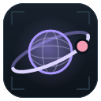

  

# Starlume

**A Star Citizen companion for Windows.** Starlume reads your game install and
makes the game's own text more useful, keeps you up to date on patches and
news, and (if you opt in) follows what CIG's developers post and shows you where
every item and ship you own actually is.

> **Starlume is young.** Things work, but expect rough edges and changes
> between releases. Feedback and bug reports are welcome in
> [Issues](https://github.com/VeeLume/starlume/issues).

## Features

### Home and News

- **Game status** for each installed channel: its version, whether your build
  is current against the patch notes (and what a later hotfix fixed), your text
  patch, and a button that opens the RSI launcher.
- **News:** the LIVE patch notes in short with a link to the full article, the
  dev cycle as a timeline (PTU waves, release candidates, LIVE, hotfixes), and
  the newest comm-links with their images.

### Dev Tracker *(opt-in)*

CIG staff posts from Spectrum, forums and chat, filtered down to game news:
patches, PTU waves, maintenance, known issues. Replies show what they answer,
you can follow the staff you care about, and game-ops posts can raise a
notification. It reads Spectrum with your RSI launcher session, so it only works
when you switch it on (see [Online and privacy](#online-and-privacy)).

### Text Patching

Patches Star Citizen's English text with information the game doesn't show:

- **Mission Enhancer:** blueprint rewards, cooldowns, crimestat risk and more in
  mission titles and descriptions.
- **Weapon Enhancer:** size prefixes, missile tracking type and combat stats in
  weapon descriptions.
- **Component Grades:** ship components labelled with class and grade, e.g.
  *Bracer Military C*.
- **Illegal Goods Markers:** drugs and contraband marked, with where they are
  outlawed.
- **Label Fixes:** shorter labels where the game's UI text overlaps.

Every patcher can be switched on or off, most have options, and a preview
shows what each one changes. After a game update Starlume re-patches on
its own as soon as it notices the update; if the game is running, it waits
until you close it.

### Mining

Will it crack? Type in a rock you scanned (or roll one from the Rock finder)
and see it against your ship:

- how hard it is for a person at the throttle, and how to fly it: where to
  keep the throttle on the charge bar and how wide the window is
- the gadget, modules or crew support that would close the gap
- the **Rock finder**: where each rock spawns, by place or by ore, from the
  game's own spawn rules, with how your ship fares on each
- **Loadouts** and **Crew**: your ships' and your crew mates' setups, each
  measured on every rock you'd meet or on one ore's

Mining reads your game install only; nothing goes online.

### My Items *(opt-in)*

Finds every item and ship on your account:

- where it is, by system, planet and station, including ship lockers and what
  you carry
- what is fitted to which ship, beside the saved and stock loadouts
- armour sets with the pieces you own, weapons with their attachments
- crafted items with their stats, and your resources by quality

My Items reads your inventory from CIG's game services, so it only works when
you switch those on (see [Online and privacy](#online-and-privacy)).

## Install

1. Download `Starlume_<version>_x64-setup.exe` from the
   [latest release](https://github.com/VeeLume/starlume/releases/latest).
2. Run it. The installer isn't code-signed yet, so Windows SmartScreen may warn
   about an unknown publisher: choose **More info → Run anyway**.

Requires Windows 10 or 11 (64-bit) and Microsoft's WebView2 runtime. Windows 11
ships with it; on Windows 10 the installer fetches it if it's missing.

**Updates:** Starlume checks for a new version when it starts and asks before
installing it. Updates are signed and verified before they're installed.

**Tray app:** closing the window keeps Starlume in the tray, where it uses very
little memory. It can start with Windows (Settings → General → Run at login).

## Online and privacy

Starlume does its work on your machine: it reads your Star Citizen install and
parses the game data locally. Online use is limited and under your control:

- **Online features** (Settings → Online & privacy → Enable online features, on
  by default) let Starlume look up your public RSI profile, read RSI's public
  patch notes and comm-links (with their images) for News, and download what
  you ask it to. Switch them off and nothing leaves your machine except the
  update check.
- **Update check:** always on, even offline, so everyone gets security fixes.
  It only asks GitHub whether a new release exists.

### Unofficial APIs *(off by default)*

Some features (My Items, the "owned blueprint" marks in mission text, and the
Dev Tracker) read through services the game client and the RSI launcher
themselves use: your own account data from CIG's game services, and RSI's
Spectrum forums and chat with your launcher session. **These are not an
official public API, and using them may be against CIG's Terms of Service.**
Starlume only reads and never changes or posts anything; the account data it
reads is only ever your own. Each feature stays off until you turn on **Allow unofficial
API calls** in Settings → Online & privacy and then enable that feature. Use
them at your own risk.

## Your data

- **Settings, caches and your inventory snapshots:** `%APPDATA%\starlume`
- **In your Star Citizen folder, while Text Patching is on:**
  `data\Localization\english\global.ini` and a `g_language = english` line in
  `user.cfg`. Switching Text Patching off removes both.

## Uninstall

Switch Text Patching off first to get the game's original text back, then
uninstall Starlume from Windows Settings → Apps. To remove its data too, delete
`%APPDATA%\starlume`.

## Not affiliated with CIG

Starlume is a fan-made tool. It is not affiliated with or endorsed by Cloud
Imperium Games. Star Citizen® and Squadron 42® are trademarks of Cloud Imperium
Rights LLC.

## Development

Building, architecture and the module rules are in
[CONTRIBUTING.md](CONTRIBUTING.md).

## License

MIT
